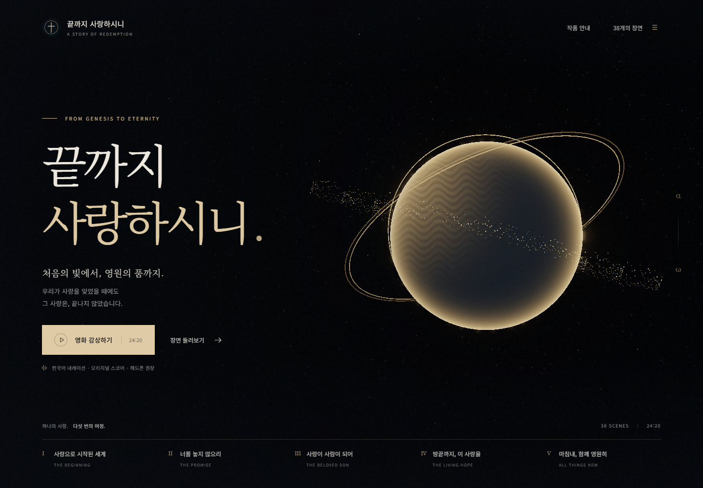

# 끝까지 사랑하시니 · Loved to the End

**처음의 빛에서, 영원의 품까지.**

창세기의 창조에서 인간의 타락, 하나님의 언약, 예수 그리스도의 십자가와 부활을 지나 요한계시록의 백보좌 심판과 새 하늘과 새 땅까지. 하나님의 사랑과 구원의 소식을 **24분 20초의 한국어 시네마**로 전하는 작품입니다.

**5막 · 38장면 · 성경 66권 안내 · 실시간 3D · 한국어 내레이션 · 오리지널 음악**



[완성본 다운로드](https://github.com/hslcrb/kingandjesuschristislord/releases/latest) · [전체 대본](public/대본.txt) · [제작 및 출처](CREDITS.md)

> A Korean cinematic journey through the biblical story of redemption, from Genesis to the new creation. A 24:20 browser film with real-time Three.js visuals, kinetic typography, Korean synthetic narration, and an original synthesized score.

## 감상하기

### 완성본으로 시작하기

1. [Releases](https://github.com/hslcrb/kingandjesuschristislord/releases/latest)에서 `loved-to-the-end.zip`을 내려받고 압축을 풉니다.
2. [Node.js](https://nodejs.org/) 22.12 이상이 설치된 환경에서 압축을 푼 폴더의 터미널을 엽니다.
3. 다음 명령을 실행합니다.

```sh
node scripts/serve.mjs
```

브라우저에서 **http://127.0.0.1:4197** 을 열고 **영화 감상하기**를 누릅니다. Windows에서는 PowerShell 스크립트 실행이 허용된 환경이라면 `start-film.ps1`로도 시작할 수 있습니다.

완성본에는 음악, 내레이션, 글꼴이 포함되어 있어 `npm install` 없이 감상할 수 있습니다. 헤드폰과 전체 화면을 권합니다. 브라우저의 자동 재생 정책에 따라 소리는 첫 클릭 이후 시작됩니다.

### 소스에서 실행하기

Git, Node.js 22.12 이상, npm이 필요합니다.

```sh
git clone https://github.com/hslcrb/kingandjesuschristislord.git
cd kingandjesuschristislord
npm ci
npm run dev
```

개발 서버는 **http://127.0.0.1:5197** 에서 열립니다. 두 개의 완성된 MP3 파일도 저장소에 포함되어 있습니다. 실행을 위해 음성을 다시 합성하거나 API 키를 준비할 필요가 없습니다.

배포용 빌드와 미리보기:

```sh
npm run build
npm run preview
```

미리보기 주소는 **http://127.0.0.1:4197** 입니다. `node scripts/serve.mjs`로도 빌드된 `dist`를 제공할 수 있습니다. `file://`로 HTML을 직접 열지 않고 HTTP 서버로 실행합니다.

현대적인 WebGL 지원 브라우저에서 감상하는 실시간 3D 작품입니다. 완성본은 브라우저에서 영화처럼 이어서 재생되며, 사전 렌더링된 MP4 파일은 포함하지 않습니다. 외부 성경 본문 링크를 제외한 감상 기능은 설치·다운로드 후 인터넷 없이 사용할 수 있습니다.

## 다섯 번의 여정

| 막 | 제목 | 이야기 |
| --- | --- | --- |
| I | 사랑으로 시작된 세계 | 창조, 하나님의 형상, 타락, 홍수와 바벨 |
| II | 너를 놓지 않으리 | 족장들과 언약, 출애굽, 율법, 왕국, 지혜, 선지자, 포로와 귀환 |
| III | 사랑이 사람이 되어 | 성육신, 예수님의 사역, 겟세마네, 십자가, 무덤과 부활 |
| IV | 땅끝까지, 이 사랑을 | 승천, 성령 강림, 교회, 은혜와 믿음의 삶 |
| V | 마침내, 함께 영원히 | 재림, 그리스도의 통치, 악의 최후, 백보좌 심판, 새 창조와 응답 |

빛과 입자, 절차적으로 만든 3D 공간, 움직이는 한글 타이포그래피가 음악과 내레이션의 시간축을 따라 전개됩니다. 자료 패널에서는 성경 66권의 핵심 해설, 관련 장면, 장면별 대본과 성경 위치를 함께 읽을 수 있습니다.


## 재생과 조작

| 조작 | 기능 |
| --- | --- |
| `Space` | 재생 / 일시정지. 버튼에 포커스가 있으면 해당 버튼 실행 |
| `←` / `→` | 10초 뒤로 / 앞으로 이동 |
| `M` | 음소거 전환 |
| `F` | 전체 화면 전환 |
| `C` | 자막 전환 |
| 시간 막대 | 원하는 시점으로 이동 |
| **38개의 장면** | 선택한 장면부터 감상 |
| **작품 안내** | 내레이션 및 모션 감소 설정 |

브라우저 탭을 벗어나거나 자료 패널을 열면 일시정지됩니다. 재생 버튼으로 이어서 감상할 수 있습니다. 자료 패널에서는 전체 대본, 음악, 내레이션도 내려받을 수 있습니다.

## 대본과 성경 근거

이 작품은 **개신교 정경 66권을 연결하는 구원사의 창작 요약과 묵상**입니다. 모든 절과 개별 사건을 재현하는 성경 전집은 아닙니다. 장면마다 성경 위치와 해설을 제공하며 짧은 직접 인용과 창작 문장을 구별했습니다. 성경 본문 링크는 Bible Gateway의 개역한글(KRV) 페이지로 연결됩니다.

종말 장면은 요한계시록 19–22장의 서술 순서에 따라 구성했습니다. 천년왕국의 성격과 재림 사건의 시간 관계에 관한 기독교 전통 안의 해석 차이는 해당 장면 해설에서 설명합니다. 새 예루살렘의 시각 표현은 본문에서 영감을 받은 상징입니다. 마지막 기도는 신앙의 응답을 돕는 예시입니다.

전체 문장은 [대본](public/대본.txt), 본문 근거와 장면별 해설은 [이야기 소스](src/story.js), 66권 안내는 [성경 목록](src/books.js)에서 확인할 수 있습니다.

## 음악과 목소리

- **음악:** 이 작품을 위해 작성한 D–F–A–E 주제와 화성 진행을 바탕으로 직접 합성했습니다. 피아노를 닮은 배음, 현악 패드, 베이스, 종, 타악이 단조의 탄식에서 장조의 귀환으로 이어집니다. 기존 곡이나 녹음 샘플을 사용하지 않았습니다.
- **내레이션:** Microsoft Edge TTS의 `ko-KR-HyunsuNeural` 한국어 합성 음성입니다. 실제 성우 녹음이 아니며, 재생성 시에는 해당 네트워크 서비스가 필요합니다.
- **동기화:** 실제 문단별 음성 길이를 바탕으로 장면 시간을 정렬했습니다. 음악과 내레이션은 각각 1,460초입니다.

자세한 제작 정보와 외부 구성요소의 라이선스는 [CREDITS.md](CREDITS.md)에 있습니다.

## 프로젝트 구조

```text
src/
  story.js        38장면의 대본, 성경 위치, 해설
  books.js        성경 66권의 요약과 장면 연결
  world.js        Three.js 장면, 카메라, 조명, 입자
  main.js         화면과 재생 조작
  timeline.js     시간축과 자막 선택
  audio.js        음악·내레이션 동기화
  timings.json    실제 음성에 맞춘 장면 길이
public/
  audio/          완성된 음악·내레이션과 작곡 정보
  licenses/       포함된 글꼴·라이브러리 라이선스
  대본.txt         전체 한국어 대본
scripts/          대본 내보내기, 음성·음악 생성, 검증, 패키징
tests/            타임라인 테스트
docs/images/      실제 작품 스크린샷
```

Three.js와 Vite를 사용합니다. 글꼴은 Noto Serif KR와 Noto Sans KR이며 빌드에 포함됩니다. 빌드 결과물과 음성 생성 캐시, 대용량 중간 WAV는 Git에 포함하지 않습니다.

## 수정과 오디오 재생성

감상에는 필요하지 않은 제작용 절차입니다. Node.js 외에 Python, `edge-tts`, PATH에서 실행 가능한 FFmpeg가 필요합니다.

```sh
python -m pip install edge-tts
node scripts/export-story.mjs
python scripts/narrate.py
node scripts/export-story.mjs
node scripts/compose.mjs
npm run build
```

대본은 `src/story.js`에서 수정합니다. 음성 생성기는 `artifacts/narration/`의 문단별 캐시를 재사용하므로, 수정한 문단에 해당하는 캐시를 제거한 뒤 다시 생성합니다. `src/timings.json`에는 실제 음성 길이에 맞춘 시간이 기록됩니다. 음성 생성 후 대본을 다시 내보내고 음악을 합성하면 새 시간축에 정렬됩니다.

완성본 ZIP 만들기:

```sh
python scripts/package.py
```

먼저 `npm run build`를 실행해야 합니다. 결과는 `release/loved-to-the-end.zip`에 저장됩니다.

## 검증

```sh
npm test
npm run build
```

별도 터미널에서 `npm run dev`를 실행하고 Microsoft Edge가 설치된 환경에서 전체 브라우저 검증을 실행합니다.

```sh
npm run verify
node scripts/regression-check.mjs
```

검증 범위는 타임라인 경계, 38개 WebGL 장면과 자막, 두 오디오의 길이와 동기화, 재생·정지·탐색, 66권 검색과 장면 연결, 모션 감소, 마지막 장면, 모바일 세로·가로 레이아웃, 버퍼링 중 시간 유지입니다. 검증 보고서와 스크린샷은 로컬 `artifacts/`에 생성됩니다.
